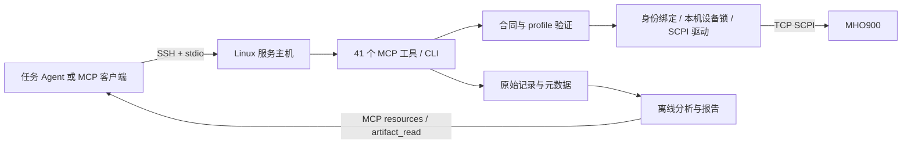

# 架构与职责

## 调用链

MCP 是客户端与工具服务之间的接口；SCPI TCP 是服务端与示波器之间的连接。
目前 MCP 只提供 stdio，通过 SSH 传输。无需增加常驻 TCP/UDP MCP 服务；SSH 负责认证与通道加密。
若以后需要常驻共享接口，应单独实现并验收 Streamable HTTP 的鉴权、会话和资源语义；UDP 不适合此工具链的请求/结果传输。

## 谁决定如何测量

任务 Agent 知道电路/固件预期行为，应提供目标、接线、预期频率/幅值/最短事件，决定触发、时基、量程和深度。
示波器服务按合同验证请求、应用参数、读回、采集并返回质量与数据。
调用方判断是否抓到了目标事件、是否需要调整，以及被测对象是否正确。
`expected_signal` 参与质量评估，不会自行生成设置或触发循环。

采用 OpenClaw 集成时，可由 oscilloscope 专职 Agent 统一执行内部测量委派。
外部设备可直接用 MCP。所有协作入口应落到同一服务主机、同一设备配置和状态目录。
框架路由约定不等于驱动锁：服务不能阻止前面板或其他主机直接修改仪器。

## 三层知识

| 层 | 提供内容 | 调用时机 |
| --- | --- | --- |
| Skill | 如何选触发、观察窗口、量程/深度，如何解释证据和收尾 | Agent 学习操作方法 |
| 合同 + profile | schema、单位、角色、版本、默认值、适用条件、摘要 | 每个新测量任务 |
| MCP schema + 返回值 | 当前可调用工具、实际读回、产物、错误和质量 | 执行与评估 |

参数优先级：本轮显式覆盖 → profile → 新鲜现场读回。
profile 需匹配物理探头，请求固定 id/version/digest，过期引用在写仪器前拒绝。
公开版携带内置 profile；自定义 profile 放在服务主机的配置目录，升级时单独保留。
不要把一份默认参数复制到每个调用设备。

## 一次采集与跨调用刺激

普通 `scope_measurement_capture` 在同一设备锁中完成配置、读回、SINGLE、导出、截图和回执，结果保持 STOP。
锁保证协作调用不会互相打断，不提供失败回滚；旧 RAM 记录不能恢复。

外部刺激采用 `scope_prepare_capture`，短时所有者进程持锁直到 collect/cancel/到期清理。
只有观测到 WAIT 才返回 ready，刺激 Agent 只接收公开 ready 信息；私有 reservation_token 留在同一调用方运行中。
AFG 可通过预约专用工具启用。取消在导出块边界执行；到期/客户端断开后尝试 STOP、关闭未用输出、深度 AUTO。
必须检查 `cleanup_complete`；网络故障或所有者进程崩溃时不能保证硬件已恢复。没有无人循环、持久任务调度或自动续传。

## 数据与迁移

原始 WORD 数据、元数据、哈希和任务回执留在服务主机。
深记录分块导出；客户端通常取选择窗口、报告或截图，整份下载另行计算耗时和空间。
MCP 资源与 artifact 工具取回文件字节，远端路径本身不等于文件已经交付。

源代码 + uv.lock + Skill + profile 构成可复用环境。实际地址、身份绑定、状态目录、SSH 权限独立于源码。
迁移时重建 `.venv`，再带走所需配置/状态；不能跨主机复制旧虚拟环境。
